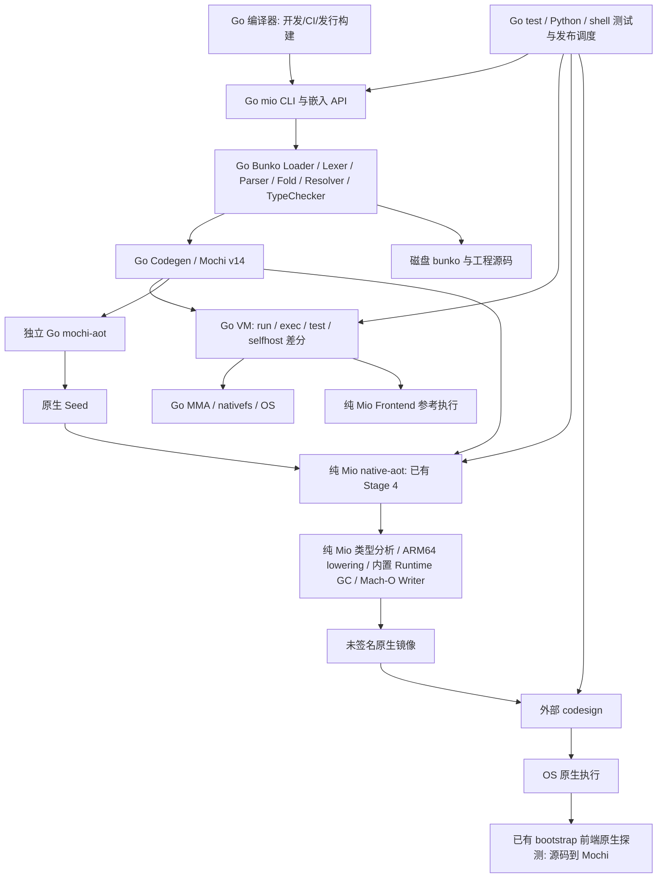

# GF0 依赖审计与源码基线冻结

日期：2026-10-26（Asia/Tokyo）。**GF0：PASS（审计交付完成）；Go-free Single Binary：NOT_ACCEPTED。GF1–GF5 未实施。**

本报告中的 PASS 仅适用于注明的检查，不代表尚未通过的语言语义、发行或隔离自举门禁已通过。本轮仅新增 GF0 审计脚本、报告和证据索引，并更新 GF0 清单；不修改编译器、Runtime、M18/M19 测试或历史验收。

## 1. 来源、保护与复现

原工作区 `/Volumes/Sector0/AppData/Mio/mio`，分支 `Mio-2`，HEAD `a96d83ca0ee30239026b9ba27d5a5d547349f647`。开始时 staged/unstaged 均为空，未跟踪内容为四份 `specs/001-go-free-single-binary/` 规范。首次快照还纳入本轮新增的 `gf0/freeze.py`。未执行 Git 写操作或创建开发分支；GF1 独立开发 worktree 留待该阶段。

完整证据根目录：[/Volumes/Sector0/AppData/Mio/mio-gf0-audit-20261026-01](/Volumes/Sector0/AppData/Mio/mio-gf0-audit-20261026-01)。该目录独立于工作区，不依赖 `/build/` 的易忽略输出。

| 对象 | 冻结结果与口径 |
| --- | --- |
| 源码 | `source/`：462 文件，包含 tracked、未忽略 untracked、被忽略的 docs；逐文件内容/原权限/字节数在 `source-manifest.json` |
| 源清单 SHA256 | `57f92e4bd36851a12aae62511e46016bd4c28ab00002db2ffaec3086d81a4ea6` |
| 历史证据 | `historical/`：6162 文件；包括 M18 verified、2026-10-26 M19c fixed-point/report/full/full-race/specialized/race-targeted |
| 历史清单 SHA256 | `aaa6e10aa344566c8ff72e2964b0c4f5c78b823591a83bff1ac31448b210f4e7` |
| 独立执行副本 | `work/` 从 `source/` 普通复制，无硬链接。所有构建、配置改写和探测只在此处或新证据子目录执行 |
| 只读保护 | `source/`、`historical/` 文件去除写权限，目录 0555；拥有者仍可改权限，故每次复核 SHA256，未宣称硬件不可变存储 |
| Git 状态 | `head.txt`、`branches.txt`、`worktrees.txt`、`worktree-status.json`、`status.txt`、staged/unstaged 二进制 patch 和 NUL 路径表 |
| 排除 | `.git` 对象数据库、IDE、缓存、其余 build/dist、`.mio` 本地应用状态不作为编译来源；避免复制本地凭据。旧二进制另取 buildinfo/hash。不是整个磁盘备份 |

工作树盘点还包括 detached `wasm-playground`、`EXP/m19-race-gate`、`EXP/m19d-admission`，完整路径和独立 dirty 状态保存在 `worktree-status.json`。未合并 M19d 或 Race 补丁。开始时确实有 M19 Race 的 `TestCodegenSelfAndBunkoSources` 进程运行（`probes/processes.stdout`），未停止它，未并发启动全仓 Race 或完整 Native 自举链。

审计可复现入口（输出必须全新；`/absolute/new-gf0` 需替换为仓库外路径）：

```sh
python3 specs/001-go-free-single-binary/gf0/freeze.py --root . --output /absolute/new-gf0
python3 specs/001-go-free-single-binary/gf0/probe.py --freeze /absolute/new-gf0 --output /absolute/new-gf0/probes
python3 specs/001-go-free-single-binary/gf0/verify.py --freeze /absolute/new-gf0 --output /absolute/new-gf0/verification
python3 specs/001-go-free-single-binary/gf0/corpus.py --freeze /absolute/new-gf0 --output /absolute/new-gf0/corpus
python3 specs/001-go-free-single-binary/gf0/dependencies.py --freeze /absolute/new-gf0
```

`freeze.py` 会保留当时的未提交来源，不假设 `git worktree add` 会复制它。`verify.py` 仅在 `work/` 暂改 bootstrap.config，并在 finally 恢复。重跑前检查进程负载；脚本单命令超时会终止自身进程组，不触碰无关进程。脚本不运行 release、全仓测试或完整自举。若历史证据目录缺失，应恢复指定证据或明确记录 BLOCKED，不能替换成另一条来源链冒充相同结果。

`tools/` 保存实际执行的审计工具副本和版本说明；`evidence-index.json` 为最终证据哈希索引。首次 probe 的 Native buildinfo 负向检查误设 expected=0，出现一个脚本级 FAIL（实际“not a Go executable”是预期结果）；修正预期及超时清理后完整重跑到 `probes-r2/`，该轮命令均符合预期。保留首轮和修正说明，性能表明确使用首轮原始数据。

## 2. 用户入口与真实默认行为

审查 `cmd/mio/main.go` 的 runCLI、parseBuildArgs、parseDiagnosticArgs、parseAndCheckFile、bunkoRoot；`cmd/mio/test_command.go`；`internal/tester/tester.go`；`mio.go`。当前源码构建 CLI 的版本为 2.0.0。实际本地候选 `build/v2.0.0-rc4/mio-2.0.0-darwin-arm64/mio` 也显示 2.0.0，help/buildinfo 已归档在 `candidate-*`；未联网查询，不声称验证了远端已发布文件。仓库根 `./mio` 是旧 V0.1.0-dev，`build/mio` 是 1.0.0-beta.1，`.mio/v1.0.0/mio` 是 1.0.0，不能用这些旧文件替代当前源码基线。

| 命令 | 当前行为 / GF0 实测 |
| --- | --- |
| version / --version | Go CLI 输出 `Mio 2.0.0`；exit 0 |
| help / -h / --help | 列出 check/run/test/build/exec/disasm/lsp；exit 0；无参数 exit 2 |
| check | Go Loader→Lexer/Parser→常量折叠→Resolver→TypeChecker；成功 `check passed`，无 VM 执行；坏类型 JSON 诊断 exit 1 |
| build | Go 前端→Go Codegen→验证/编码 Mochi v14；默认 `hello.mochi`，**不是 Mach-O**；`-o` 接受前置或路径后置 |
| run | Go 前端编译后在本进程 Go VM 执行；`-- arg1` 当前不支持，实测 exit 2 |
| exec | Go 解码器读取 Mochi，再执行 Go VM；不是 Native AOT |
| test | Go 发现 `_test.mio`、过滤/本地化/JSON 汇总，`internal/tester` 编译、VM 执行；`bunko/kiso/path` 实测通过 |
| disasm / lsp | Go 解码与反汇编 / Go LSP 服务；同属真实兼容入口，规范未指定其最终迁移范围，GF3 前需明确承诺 |
| mochi-aot | 独立 Go 程序，Mochi→未签名 Mach-O，提示用户调用 codesign；默认 heap 1 MiB、显式最大 1024 MiB |
| native-aot | 纯 Mio 后端原生镜像；从 cwd 的 input.config/output.config 读取路径，输入仍为 Mochi，默认 heap 1 GiB；无统一 CLI |

改变 build 默认产物、run 的 VM 执行语义、exec 契约和参数转发，都需要 GF3 版本化迁移决策。当前 run 本来就是 VM，未发现它先 Native 失败再偷偷降级；未来统一流程必须失败即失败。

## 3. 全链路与依赖分类



`dependencies/graph.json` 完整保存 **241 个包节点**及 production Imports、TestImports、XTestImports、ForTest、源码文件列表；其中 108 个是 Mio 节点（含测试变体，不等于 108 个独立源码包）。`go-list.jsonstream` 是原始 Go 工具输出。`probes-r2/static-calls.stdout` 全量列出子进程/Go/签名/调度调用位置，`imports.stdout` 保存 Bunko/自托管模块导入与绑定，`test-inventory.stdout` 保存测试和跳过入口，`pure-errors.stdout` 保存实现的失败边界。图是这些完整清单的摘要。

| 类别 | 实际来源 / 最终替换范围 |
| --- | --- |
| Go 构建期 | go.mod 声明 Go 1.22.2；实测工具链 1.25.9。`go list -m all` 仅 Mio，无第三方 Go module；仍依赖 Go 标准库和 Runtime |
| 二进制内 Go Runtime | 当前 mio、mochi-aot、mochi-aot-audit 都由 Go 构建。新 CLI buildinfo 显示 compiler=gc、CGO_ENABLED=0；nm 明确含 runtime 和 Mio/internal/vm。静态自包含不等于 Go-free |
| Go VM 执行 | `internal/vm`、`internal/value`、`internal/tester`、mio.Environment.RunWithOptions；selfhost 的 Go 差分 harness 仍调用 Environment.Run；LSP 也为 Go |
| Go 前端 | `internal/lexer/parser/constant/resolver/typecheck/compiler/mochi/bunko`；根 mio.go 是 Go 嵌入 API，不是统一纯 Mio 入口 |
| Go host binding | stdlib.NewRegistry 只注册 `internal/nativefs` 的 `mio/fs/runtime`，共 14 项 open/file_status/read/write/close/stat/mkdir/open_dir/dir_status/dir_next/dir_name/dir_is_dir/dir_is_file/dir_close；MMA 用 Go resource 生命周期管理 |
| NativeFS 替代 | 纯 Mio lower/nativefs 和 Go reference darwinarm64/m14_nativefs 发出 Darwin syscall bridge；不能把当前 fs 绑定整体说成 Go-only。现有原生前端已读目录/文件并写输出；完整错误/资源语义仍需 GF1 回归 |
| 纯 Mio 前端 | selfhost lexer/parser/resolver/typecheck/codegen 与 bootstrap loader；已有内存 AST/符号/检查/CompileResult API，可复用；当前 bootstrap 写死编译 selfhost/bootstrap、根目录 `.`、config 输出路径及 14 个绑定签名哈希 |
| 纯 Mio 后端 | encoding/mochi 解码→lower/types→lower/Runtime/GC→arm64 assembler→macho Writer；Mochi IR 可保留，无需生产 VM |
| Bunko | CLI 查 MIO_BUNKO、源码祖先 bunko、最后 cwd/bunko；loader 必须 EvalSymlinks/ReadDir。overlay 不能免除物理目录发现。无源码资源 manifest/内嵌 Bunko；删除安装目录的导入探测实测失败 |
| OS / 签名 | 输出 Runtime/GC 直接编进镜像；当前 Writer 输出 unsigned，外部 codesign 才签名。otool 未列 Stage 4 动态库；允许 OS 基础库也不表示禁止 OS API。内置 ad-hoc CodeDirectory/LC_CODE_SIGNATURE 尚无交付证据 |
| 测试与审计工具 | Go test、Python 3、shell、codesign、sandbox-exec、LLDB、file/otool。LLDB 用于 GC 见证，审计工具允许存在；当前签名却是普通产物执行的实际外部步骤 |

未发现当前普通 Native lowering 调用 clang/LLVM/ld；它们也不是已实现链的必要组件。无 Go 的 CLI 探测即使 PATH 空仍成功，是因为 Go Runtime 已内嵌。GF0 记录了这一反例，未据此判 A2 通过。

CI/发行：ci.yml 的 Go full/AOT/race、Go 构建工具、check-native-bootstrap.sh 与 Python M18 fixed-point 仍依赖 Go。旧 bootstrap shell 每代都调用 Go AOT，并临时改 bootstrap.config，不是 GF4；M18 Python 则 Go frontend 生成共同 Mochi，Go AOT 仅造 Seed，之后 Native backend 生成各代。release.yml 使用 Go 测试、Python、codesign、sandbox/LLDB；prepare-release.py 构建三件 Go 工具，再复制 Stage 4 为 native-aot，附带 native-aot.mochi、磁盘 Bunko、examples/docs、Go 许可等。当前包至少四个工具链可执行文件，A1 不通过。release-candidate.yml 是 Python/PyYAML 静态策略入口。所有这些只静态审计，未触发工作流或发布脚本。

## 4. 真实 Native Frontend 探测与缺口

本轮先由冻结源码的 Go 前端生成 `bootstrap.mochi`；Go AOT 和历史 M19c Stage 4 都成功将它降为 Native。随后执行 **Stage 4 产生的** `verification/frontend.native`，在空 PATH、禁止 fork/exec 的沙箱中从 `work/` 读取真实 selfhost/Bunko 源码，生成 `compiler-B.mochi`：

- exit 0，输出 `bootstrap: ok / 120707 / 477 / 497 / 1`；真实生成 120707 bytes。
- SHA256 `b44a55bf3f9020e6b0ff83ad137b25774814a32dfe8acaf070abcd167bfd1465`，与既有 M17e 黄金一致。
- 缺 config 时却输出 `bootstrap: configuration unavailable` 且 **exit 0**。Native backend 的 decode/lower 失败同样可能 exit 0，必须同时查 marker、新文件和内容。
- 这是未修改已有实现的审计探测，证明该固定前端工作负载能原生执行；不是 GF1 全面语义/诊断验收，也没有宣称 GF4。

从已存在 `TestCodegenExecutionDifferential` 原样抽取 16 个源码样例，每例 Go 前端产生 Mochi，分别运行 Go VM 与沙箱中的纯 Mio Stage 4，签名新副本并执行；原始源码、IR、原生输出、签名日志、stdout/stderr 和 hash 全保存在 `corpus/`。**11 PASS、4 BLOCKED_NATIVE、1 FAIL**：

| case | 特征 | 实测与实施定位 |
| --- | --- | --- |
| 0–8、11–12 | 控制流、作用域、函数、int64 极值、常量、数组、nullable、struct、enum、共享 Cell 和嵌套 closure | stdout 与 VM 一致，正常 Native exit 0；不能推广为所有边界均通过 |
| 9 | Map[string,int64] 创建/写/读 | `lowering failed / 2 / 41`，UnsupportedOpcode OpMap；41/42/43 已在 VM/Codegen 定义，纯 Mio lower 缺路径 |
| 10 | 顶层无捕获函数值 `add` | `decode failed`，Go VM 成功；需缩减 decoder/函数索引/闭包约束差异，尚未确定根因，不能笼统宣称 Closure 未实现 |
| 13 | 同一泛型 identity 分别调用 int64 和 string | `lowering failed / 8 / 1025`，UnsafeType；疑似跨实例表示合并，应审计单态化/类型 arena，而非关闭精确 Root 检查 |
| 14 | int8(127)+1、uint32(4294967295)+1 | **Native 128、4294967296；VM -128、0**。静默错误，是迁移阻塞。定位窄整数 descriptor、算术截断与有符号扩展；本轮未修复 |
| 15 | float32 精度、float64 -0.0 与转换 | `lowering failed / 8 / 1622`，UnsafeType；需缩减类型传播/Chant/转换案例，未将它描述为全部浮点不支持 |

除此之外：入口参数/非零错误退出/项目与模块加载/常量折叠和泛型语义差分、原生测试发现与汇总、argv/env/stdout-stderr/执行用户程序的 OS bridge、Bunko 内嵌、前后端公共 IR/ABI、原生签名均未统一。当前 frontend CompileResult 是编码 bytes/layout，backend 消费 mochi.File；不能将同为 v14 误当已存在无序列化的公共内存模型。M19c 的 opt-in heap/LOS/pressure 策略与 CLI 默认资源协议也需显式迁移；M19d 保持独立，不自动接入。

## 5. 固定点与历史验收核验

`verification/history.json` 重新计算 M18 verified 与 M19c 2026-10-26 fixed-point 的 Stage 1–5 **完整未签名字节相等**，逐代 SHA256 与 provenance 一致，并调用既有 Mach-O 结构检查器验证。M19c 历史 source-manifest 的所有相关源码与本轮冻结源码一致；M18 旧源码则有后续 M19 差异，差异逐文件保留。

| 证据 | 本轮核验结果 |
| --- | --- |
| M18 Stage 1–5 unsigned | PASS，SHA256 `1fe684077b0e0aba6a9e8f73cb062b5f0b1e94e35f36da683cf0fc94d9fedb2d` |
| M19c Stage 1–5 unsigned | PASS，SHA256 `00a665b229ccb35a5ef291821865c455ad887e021ac92ee60fcf68d44c79c833` |
| M19c Stage 4 签名/执行 | 本轮 strict verify、Hello lowering 和生成程序执行、前端 lowering 都成功；完整代际链未重跑 |
| 历史执行范围 | provenance 记录 Seed 和 Stage 1–4 实际生成下一代；Stage 5 为生成/解析/签名继续见证，未冒称执行 |
| M19c GC 见证 | 已冻结原记录 gc=19 / minor=17 / major=2、shadow_frame=0、exit_argument=0；本轮未用 LLDB 重跑 |
| 全仓普通测试 | 历史 2026-10-26 full PASS / 318.48s，保留 sources/result/log；本轮未重跑 |
| Full Race | 历史 full-race **FAIL** / exit 1 / 1818.61s，30m 超时；M19b 门禁继续 **NOT_ACCEPTED**，其它工作树的新结果不自动覆盖 |

固定点比较只用未经签名的全部 Mach-O 字节，不标准化掉未知差异，不把签名字段变化藏在比较规则中。该链输入始终是共同 `.mochi`，不能等同于 GF4 每代从 `.mio` 构建完整统一编译器。

## 6. 当前性能冻结

主机 macOS 15.6.1 (24G90)、Darwin ARM64、Apple M4 Pro、24 GiB，Go 1.25.9；Go probes 限 GOMAXPROCS=2、build -p=2、CGO_ENABLED=0。存在其它 M19 Race CPU 负载。`/usr/bin/time -l` 原始 stderr 保存 CPU、RSS、页错误、instructions/cycles，Python 单调时钟记录完整调度 wall。不可拿这些样本宣称性能提升。

| 不变输入 / 流程 | wall 秒 | user/sys 秒 | 峰值 RSS MiB |
| --- | --- | --- | --- |
| Hello Go 前端 build，3 次新进程 | 0.0094 / 0.0102 / 0.0096 | 各 0.00 / 0.00（工具精度不足） | 5.03 / 4.84 / 4.92 |
| selfhost/bootstrap Go 前端 build，首次 | 0.0751 | 0.04 / 0.01 | 25.81 |
| 同一大型输入再次 build，3 次 | 0.0722 / 0.0742 / 0.0749 | 各 0.04 / 0.01 | 24.97 / 25.22 / 25.59 |
| 纯 Mio Stage 4：bootstrap Mochi→Native | 1.6471 | 0.84 / 0.75 | 304.55 |
| 该 Native Frontend：冻结源码→Mochi | 11.2563 | 9.69 / 0.95 | 272.67 |
| 纯 Mio Stage 4：Hello Mochi→Native | 0.3373 | 0.00 / 0.00 | 2.97 |

`performance.json` 关联每行原始命令。首次是独立进程冷启动，不是经清缓存证明的冷磁盘；重复样本为 OS 缓存已热的重新编译，不是增量编译。未清 OS cache；目前无持久增量 API，增量基准为 BLOCKED。GF2 尚无单进程源码到 Native，不能把不同阶段的 RSS 相加当总峰值，也不把含沙箱启动的 Hello AOT 时间当纯代码生成时间。原生前端单次样本不足以建立可信性能分布，空闲窗口补测计划见下节。

## 7. 前置条件状态与后续顺序

| 检查 | 状态 | 证据 / 阻塞 |
| --- | --- | --- |
| HEAD/worktree/dirty/源码冻结/原树保护 | PASS | freeze.json、Git 记录、verification/integrity.json、final-integrity.json |
| 用户编译/运行/测试/CI/发行路径可追踪 | PASS | 入口表、Go graph、static-calls、imports、test-inventory |
| 当前 Native backend 固定点证据 | PASS（历史重验） | 完整字节与 Mach-O、provenance；不是新链 |
| 固定自托管前端的 Native 执行 | PASS（局部） | compiler-B.mochi 黄金一致；需要可信历史 Stage 4、磁盘源码 |
| GF1 所需通用语义一致 | BLOCKED | corpus 的 4 阻塞 + 1 静默错误；诊断/任意工程覆盖不足 |
| 单进程统一 CLI、内嵌 Bunko、内置签名 | BLOCKED | 尚无统一实现，依赖磁盘资源、config、外部 codesign |
| 可测当前耗时/CPU/RSS | PASS（有限样本） | performance.json；冷磁盘、增量、空闲窗口分布另列未执行 |
| 新完整 Native 自举、全仓/Full Race、GC/LOS/OOM 全回归 | NOT RUN | 避免与活跃 M19 重型任务并发；无替代 PASS |
| 全量文件访问/子进程追踪、干净无 Go OS 重建 | NOT RUN | 当前仅 backend/frontend 启动沙箱禁止 fork/exec，反向探针 exit 71；允许文件访问，未证明资源自包含 |
| 最终 A1–A12 / GF1–GF5 | NOT_ACCEPTED | 尚未达到单文件、语义一致、统一源码自举和无 Go CI |

**GF1（唯一下一实施阶段）**：从冻结清单建立独立 worktree/副本并逐文件核对，保留 M19c、隔离 M19d。先为上述五例建立最小失败输入，分别核对 Go frontend IR、纯 Mio frontend IR、decoder 和 lower，分清前端/后端职责；修复窄整数静默错、Map/函数值/泛型/浮点阻塞时保持准确 pointer layout、Shadow Frame 和 GC。不以拒绝已验收语义缩小语言来过关。将现有 bootstrap driver 泛化为实际源码入口、模块加载、非零诊断；仍只输出 Mochi。差分覆盖 16 例、错误输入、模块和完整 selfhost/Bunko；输出比对先定确定性规则。空闲验证窗口再跑当前固定点与 GC/LOS/OOM/NativeFS、普通/必要 Race；保留失败样本。GF1 验收前不给 GF2 开工。

**GF2（GF1 通过后）**：确定前端/后端公共内存 IR、layout/native binding/version 契约并连通；不得用第二个 compiler 进程连接。先 Hello、模块、nullable/array/Cell/数值/错误垂直片，执行真实 Mach-O，并测全过程资源。禁止 VM 回退。

**GF3（GF2 通过后）**：形成统一纯 Mio CLI；先决定 build/run/exec/disasm/lsp 的版本迁移范围，补 OS argv/env/exit/用户程序运行和 Native test runner；把 Bunko/资源清单及可信哈希内嵌，接入 native ad-hoc 签名。只装一个 mio、无外部 Bunko、空工具 PATH 的离线安装测试，加文件访问与进程追踪。

**GF4（GF3 通过后）**：固定可信原生 Seed 的来源/哈希、全源/内嵌资源清单及完整未签名字节比较口径；隔离无 Go 环境执行 .mio Seed→A→B→C→D，真实执行所需各代并核对 B=C=D；完整 GC/稳定地址/LOS/OOM/跨代回归。本轮 Stage 4 不是统一编译器 Seed，不可直接宣称满足此阶段。

**GF5（GF4 通过后）**：迁移生产 CI、测试发现与发行打包；保留 Go 参考与历史测试直到覆盖获验收，明确 Full Race 既有失败和替代策略审批；在无 Go 环境从源/Seed生成单文件包、签名及来源证据。发布仍需单独人类授权。本轮未执行 Commit、Push、Tag 或 Release。
