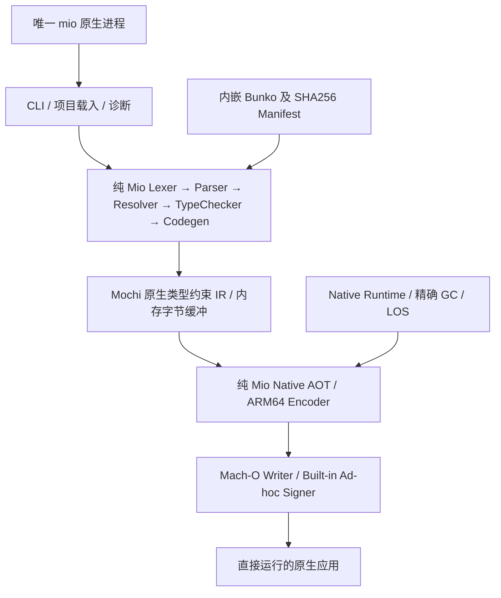

> 最高优先级修订（用户 2026-10-26）：遵守 [PURE_MIO_ARCHITECTURE.md](PURE_MIO_ARCHITECTURE.md)。正式组件、构建、自举、发行链必须全部由 Mio Native 实现；其他语言仅限隔离参考审计。未经授权禁止 Commit、Push、Tag、Release。旧条款冲突时以此修订为准。

# Mio Go-free Unified Native Toolchain — Specification v0.2

**状态：** DRAFT → 需真实实施与验收  
**执行范围：** GF1～GF5 连续执行；GF0 已完成审计  
**首个平台：** Darwin/macOS ARM64  
**最终形态：** 一个叫 `mio` 的纯 Mio 原生可执行文件

本规范使用 **MUST** 表示硬性验收条件，**SHOULD** 表示默认工程约定。

## 1. 用户所期望的唯一工具

安装后，用户无需 Go、Go VM、独立 Mochi VM、`mio-front`、`mio-aot`、外部链接器或独立 Bunko 安装目录，仅需 `mio` 即可执行：

```sh
mio version
mio help
mio check hello.mio
mio build hello.mio -o hello
mio run hello.mio -- arg1 arg2
mio test ./...
```

`mio` MUST 是纯 Mio Native 编译链产生的原生 ARM64 Mach-O，不可将 Go 可执行文件更名为 `mio`、把 Go Runtime 打进二进制或隐藏调用 Go 程序。生成的用户应用必须原生独立执行，并内嵌所需原生 Runtime/GC。

单文件意指**一个必须安装的编译工具可执行文件**；不要求用户项目、源码、数据或第三方依赖也嵌入其中。允许使用操作系统基础 API/系统库。正式 CI/发行构建、打包、测试运行器和工具链服务 MUST 由 Mio Native 完成，不得依赖 Python/Go/C 等外部语言工具链。外部 OS 验签与历史参考工具只能位于隔离审计环境，不得生成正式发行产物或成为其构建前提。

## 2. 真正的正常编译链



- 前端与后端 MUST 运行于**同一个进程**。GF2 初期允许 Mochi 序列化、反序列化，但只能经内存 buffer；不能借此启动第二个编译器或写临时 `.mochi` 再调用其他程序。
- `Mochi v14` 历史格式保持可读；原生编译的声明类型传递采用 [v15 类型约束修订](TYPED_IR_V15.md)。IR 可作为导出产物，正常构建不得由 Mochi VM 解释执行。新增格式仍必须通过全部兼容性和原生门禁。
- 遇到不支持的语义 MUST 明确诊断、非零退出；不允许静默降级到 Go/VM。输入错误、解码失败、lowering 失败及 OS 错误都必须可区分。
- 原生应用 MUST 编入必要 Runtime、Shadow Frame、精确 GC、已通过集成验证的 M19b/M19c 内存模型；不得为过关偷偷回退到旧堆或禁用精确布局。
- GF0 固定 bootstrap 上的输出正确并不代表任意源码已通过。GF1 以真实源码与差分为正式门槛。

## 3. 语义契约

MUST 维护已验证的 Mio 语义：固定宽度整数的回绕、`float32` 精度与有符号零、泛型单态化/表示、Nullable、数组共享引用、Map、函数值和捕获 Closure/Cell、Enum/Struct、错误诊断、函数调用 ABI、NativeFS、类型精确布局。

GF0 五个失败/阻塞 Case（9/10/13/14/15）全部是 GF1 必修项，不允许改期望结果、禁用功能或删除用例。要在 Go 参考前端/VM、纯 Mio 前端/纯 Mio Native 之间定位差异，再修复真正有问题的层。需要扩充更广泛测试，16 例仅是冒烟集。

## 4. CLI 行为与兼容

- 新统一版本的 `check`：纯 Mio 前端静态诊断，不运行应用。
- `build`：默认生成当前主机原生 Mach-O；明确选项（可取 `--emit=mochi`）允许导出 Mochi 供工具使用。
- `run`：同一 `mio` 进程编译 Native 并运行**用户应用**；`--` 之后传递 argv，保留退出码和 stdout/stderr。
- `test`：纯 Mio 发现 `_test.mio` 与 `test_`、编译并运行原生测试，汇总真实通过/失败。
- `version/help`：实际发行版本、支持目标、帮助与错误使用码一致。
- 现有 `exec`（曾经 Go VM）、`disasm`、`lsp` 都在 GF3 迁移范围内，**MUST 在统一 `mio` 中提供纯 Mio Native 对等入口**。`exec` 应通过 Native AOT 处理 Mochi，`disasm` 使用原生 Decoder，`lsp` 需实现原生 JSON-RPC 服务。不能以删除现有命令或隐藏 Go 工具作为完成证明；遇到未实现时 GF3 保持 `NOT_ACCEPTED`。
- GF0 已确认原有 `build` 输出 `.mochi`、`run` 走 VM，必须显式发布 breaking-change 迁移说明。不能把新的默认行为说成旧 CLI 原有行为。

## 5. 内嵌 Bunko 与签名

- `mio` MUST 内嵌版本化、可重现排序、带哈希和长度的 Bunko/编译资源清单。`yobu "kiso/math";` 无需磁盘 `bunko/` 即可工作。
- 允许通过明确的开发选项覆盖 Bunko 来源，但该选项不得是发行用户的必要条件；覆盖要可诊断、不能污染发行二进制的固定点。
- 输出 Mach-O MUST 带可通过 macOS 严格校验的有效本地 ad-hoc 代码签名。普通 `mio build` 不得要求用户手动执行 `codesign`；测试可用 OS `codesign --verify --strict` 复核。
- Apple Developer ID、notarization 是独立发布权限/凭据问题，不得声称已经完成或在普通用户构建时强制要求。

## 6. Go-free 的准确含义

- 允许在迁移早期使用**已验证的原生 Seed**。Seed 历史上可能借助 Go 创建，但 GF4 自 Seed 起的完整 `.mio` 源码编译链不得调用 Go、Mochi VM 或外部编译器/链接器。
- GF5 的生产构建/测试/发行流程应不需要 Go 安装；历史 Go 实现可在仓库隔离为参考/兼容源，但不可参与发行 `mio` 的构建闭环。
- PATH 中删除 Go 只是一种负向检查，还必须检查 Mach-O/符号/buildinfo、依赖、子进程追踪及真实构建来源。
- GF4 比较每一代完整的**未签名 Mach-O**，以事前固定的规则证实 B=C=D；签名产物单独验证，不能跳过不同机器码字节。

## 7. 与 M19 并行的边界

- M19b 旧 Full Race 超时保留 `NOT_ACCEPTED`，GF1～GF5 的新 Native 测试不能替它标记 PASS。
- M19c 独立功能 PASS（LOS、稳定对象地址、自动 Heap、Memory Pressure），在 GF 目标中应保留相关集成语义和回归。
- M19d 单线程 Admission Core 已在 `mio-wt-m19d` 独立通过，但未合并：**不得擅自把该 worktree 变更当作 GF 基线**。它不构成 GF1～GF5 的必须实现目标。
- 不提前实施 M19e 并发 Old GC 或 M19f 三档调节器，也不同期强制完成 Linux/Windows。

## 8. 通过与发布边界

GF1～GF5 各有独立真实验收门槛。只有最终整合源码的 `acceptance.md` A1～A12 全部满足且来源证明充分，才能标记 `GO_FREE_SINGLE_BINARY=PASS`。不能因为用户请求“全自动”便假定所有阶段均必然成功。

允许 Codex 自主完成本地开发、测试、CI 预演和准备工作；**禁止自动 Push、Tag、正式 Release 或不可逆远端操作**。首次公开发布另需维护者触发 Tag 或批准签名/上传。
